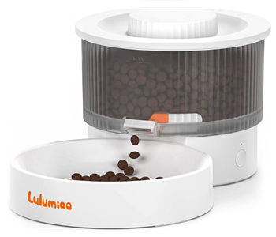

# ASF02 Pet Feeder Integration for Home Assistant



This custom integration lets you monitor and control the ASF02 Bluetooth pet
feeder from Home Assistant. Everything runs locally over Bluetooth — there is
no cloud and no vendor server in the loop. The integration exposes read-only
sensors for battery level, feed count, schedule, and device time, a Feed
button (with a Portions number) for on-demand feeding, and services to stop
a dispense and manage the feeding schedule.

## Features

- **Bluetooth discovery**: automatically finds ASF02 feeders in Bluetooth range, or add one manually by MAC address.
- **Read-only sensors**: battery, feed count, the current schedule, and the feeder's internal clock.
- **Feed button**: set how many portions in the **Portions** number, press **Feed** — no scripts needed.
- **Schedule slot editor**: change the time and portions of one schedule slot from the dashboard, then write it to the feeder with a button press.
- **Dispensing services**: feed a number of portions on demand, stop a dispense in progress, and set or clear the feeding schedule.
- **Adjustable polling**: choose how often the feeder is read, from 1 minute up to 1 hour.
- **Local-only**: all communication happens over Bluetooth, directly from your Home Assistant.

## Requirements

- Home Assistant **2026.9.3 or newer**.
- A way for Home Assistant to use Bluetooth — a Bluetooth adapter on the host,
  or a Bluetooth proxy (for example an ESPHome `bluetooth_proxy`). See the
  [Bluetooth integration](https://www.home-assistant.io/integrations/bluetooth/).
- The feeder itself, powered on and in Bluetooth range.

The feeder supports a single Bluetooth connection at a time. If the vendor's
phone app is open and connected to the feeder, it will compete with Home
Assistant for that connection. Keep the vendor app closed while Home Assistant
is in use.

## Installation

### 1. Install

Choose one of the following methods to install the integration:

A. Install via HACS (recommended)
   - Open Home Assistant and click on **HACS** in the sidebar.
   - Search for **"ASF02"** and select it.
   - Click **"Download"**.

B. Install manually
   - Copy the `custom_components/asf02` folder into your Home Assistant `config/custom_components/` directory.

### 2. Configure

   - **Restart Home Assistant**.
   - After restarting, navigate to **Settings > Devices & Services**.
   - Click **"Add Integration"**, find **"ASF02 Pet Feeder"**, and follow the
     prompts.

If the feeder is advertising, it will be discovered automatically and shown in
a device picker. You can also add it manually by entering its MAC address.

## Setup

The integration automatically identifies ASF02 feeders in Bluetooth range —
no MAC address or token to look up. When one is discovered, add it from
**Settings > Devices & Services**. (You can also add one manually by MAC
address.)

During setup you're offered a **new pairing token** — the normal path, since
the original token can't be read back out of the vendor app. Taking it
re-pairs the feeder, and **any schedule already on the feeder is lost**.
Re-create the schedule afterwards with the `asf02.set_schedule` service.

## Entities

Once configured, each feeder appears in Home Assistant with the following
entities.

### Sensors

| Sensor | Description |
| --- | --- |
| **Schedule** | The feeding schedule Home Assistant is keeping, shown as a readable list of times and portions. It updates when you save a slot and refreshes whenever the feeder answers a schedule read. |

Battery, feed count, and device time live in the entity picker's
**Diagnostics** section:

| Sensor | Description |
| --- | --- |
| **Battery** | A number that reflects the battery's charge — higher when fresh, lower as it drains. It is not a percentage (the value depends on how the feeder is powered). |
| **Feed count** | Total portions dispensed. Counts up and never resets. |
| **Device time** | The time shown on the feeder's own internal clock. |

### Numbers

| Number | Description |
| --- | --- |
| **Portions** | How many portions the **Feed** button will dispense (1–99). Remembers its value across restarts. |
| **Slot portions** | The portion count for the schedule slot being edited (1–99). Used with **Slot time** and **Save schedule**. Found in the entity picker's **Control** section. |

### Times

| Time | Description |
| --- | --- |
| **Slot time** | The time of day for the schedule slot being edited. Used with **Slot portions** and **Save schedule**. Found in the entity picker's **Control** section. |

### Buttons

| Button | Description |
| --- | --- |
| **Feed** | Dispenses the number of portions set in the **Portions** number. Returns as soon as the feeder accepts the command; the feed count catches up as the motor runs. |
| **Save schedule** | Writes the current **Slot time** and **Slot portions** into the slot chosen in the options and saves the full schedule to the feeder. Found in the entity picker's **Control** section. |
| **Refresh** | Polls the feeder immediately (bypassing the poll interval) and updates its entities. Found in the entity picker's **Control** section. |

Note: the integration keeps its own copy of the 10-slot schedule (the
feeder's schedule read is unreliable on in-use firmware). That copy starts
empty, so the first **Save schedule** press writes a full 10-slot schedule —
if the feeder already has a schedule that Home Assistant couldn't read,
enter the full schedule you want before the first save.

## Services

The integration provides four services. Each takes one or more `entity_id`
values so it can be pointed at a specific feeder.

### `asf02.feed`

Dispenses a number of portions immediately. By default it returns as soon as
the feeder accepts the command and does not block; set `wait` to `true` to
block until the dispense finishes.

```yaml
service: asf02.feed
data:
  entity_id: sensor.my_feeder_feed_count
  portions: 2
  wait: false
```

- `entity_id` (required) — the target feeder entity.
- `portions` (required) — how many portions to dispense, 1–99.
- `wait` (optional, default `false`) — block until the dispense completes.

### `asf02.stop`

Stops a dispense that is in progress. If the feeder is idle it does nothing.

```yaml
service: asf02.stop
data:
  entity_id: sensor.my_feeder_feed_count
```

### `asf02.set_schedule`

Replaces the feeder's entire schedule. Provide up to 10 entries, each with a
time, a portion count, and an optional enabled flag. This is best driven from
a script or automation.

```yaml
service: asf02.set_schedule
data:
  entity_id: sensor.my_feeder_feed_count
  entries:
    - time: "08:00"
      portion: 2
      enabled: true
    - time: "18:00"
      portion: 1
```

- `entity_id` (required) — the target feeder entity.
- `entries` (required) — a list of up to 10 entries. Each entry has `time`
  (`HH:MM`), `portion` (1–9), and an optional `enabled` (boolean, default
  `true`).

### `asf02.clear_schedule`

Removes all schedule entries.

```yaml
service: asf02.clear_schedule
data:
  entity_id: sensor.my_feeder_feed_count
```

## Options

- **Poll interval (minutes)** — how often Home Assistant reads the feeder,
  from 1 minute to 60 minutes (default 15). A shorter interval updates the
  sensors faster but drains the feeder's battery more quickly. Use a 1-minute
  interval only while troubleshooting.
- **Schedule slot** — which slot of the feeder's 10-slot schedule (1–10,
  default 1) the **Slot time** and **Slot portions** entities edit.

Change this from the integration's options without restarting Home Assistant.

## Troubleshooting

### Device not discovered

1. Make sure the feeder is powered on and **not already connected to the vendor phone app** — the feeder can only talk to one device at a time.
2. Power-cycle the feeder and try again.
3. Check that Bluetooth is enabled on your Home Assistant host or that a Bluetooth proxy is configured.
4. Confirm the feeder advertises with a name beginning `ASF02-` (visible in the Bluetooth integration's device list).
5. If it is still not found, add it manually by entering its MAC address.

### Setup fails to connect or rejects the token

- A connection error usually means the feeder is out of range or the Bluetooth
  path is unavailable — check the adapter or proxy and try again.
- If the token is rejected, the feeder may have been re-paired through the
  vendor app. Re-run setup and choose the **generate a new token** option to
  re-pair the feeder.

### Nothing is dispensing

- Confirm the feeder is not currently locked out by the vendor app.
- Check the **Feed count** sensor — it increments as soon as the feeder
  accepts a dispense. Use the **Refresh** button to poll the feeder
  immediately instead of waiting for the next interval.
